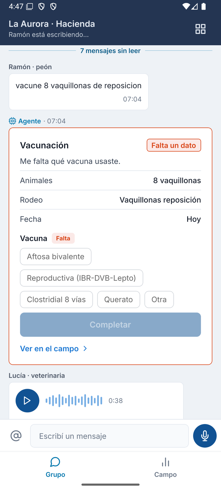
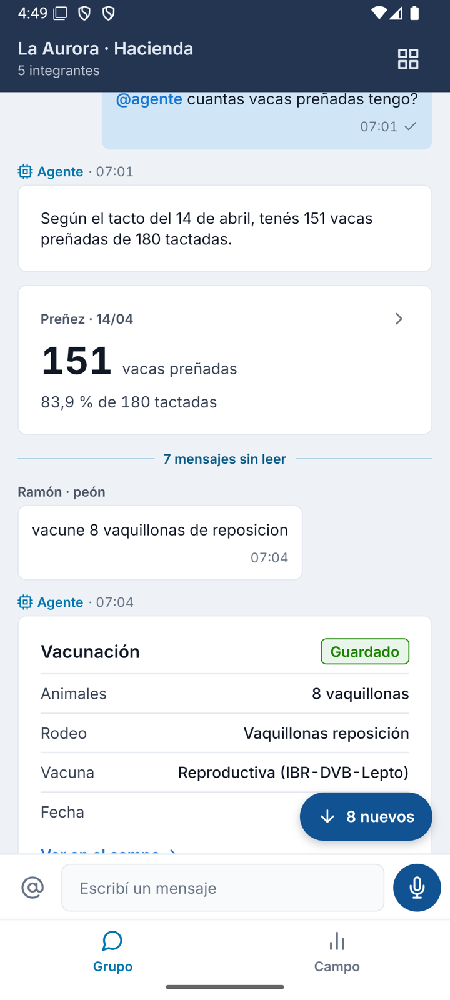
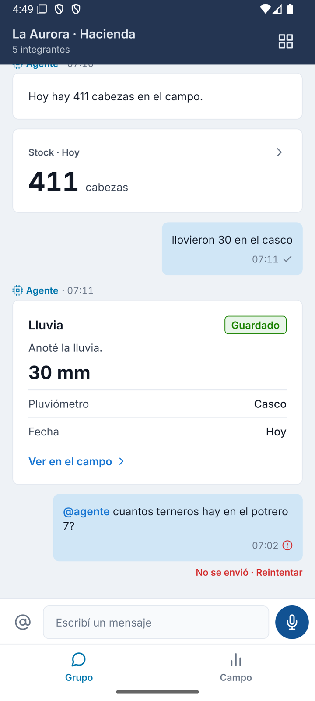
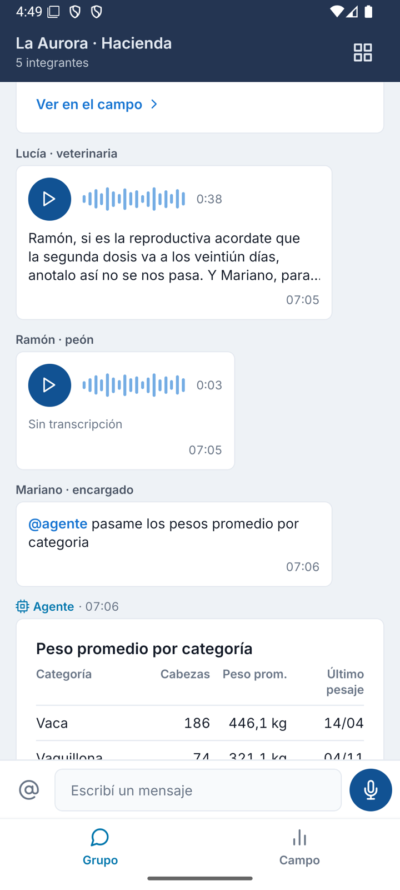
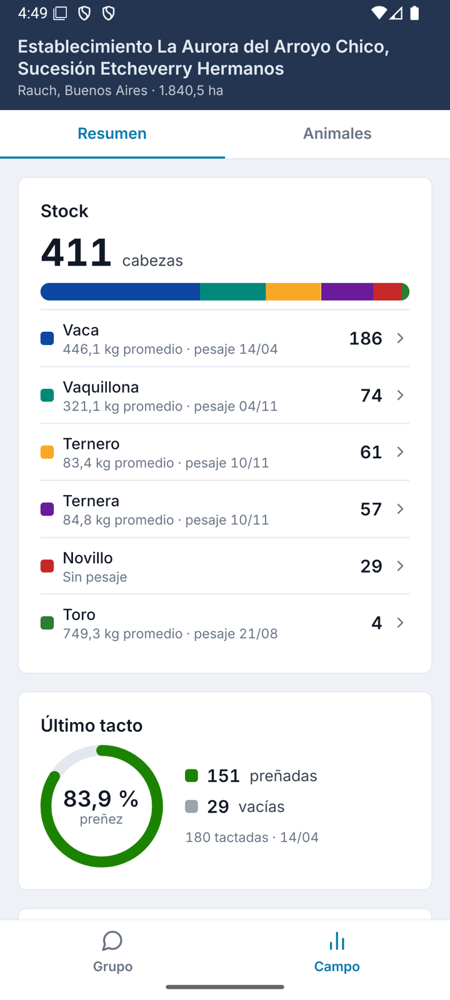
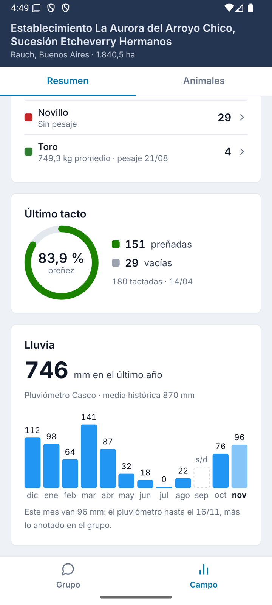
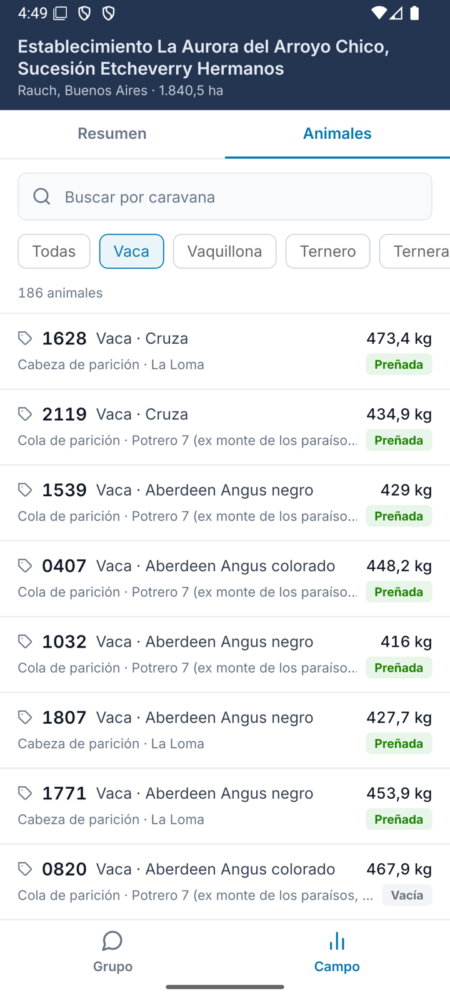

# Trial Mobile · FieldData

Una app en Expo para el grupo de un campo ganadero y sus datos. Tiene dos vistas que se hablan entre sí:

- **Grupo:** el equipo charla y el agente anota datos y responde consultas.
- **Campo:** el stock, el último tacto, la lluvia y los animales.

No hay backend. Usa `mock-server.ts` y `mock-data.json` tal como vienen, sin modificarlos.

Guía de flujos y casos borde, con el recorrido de cada evento: <https://joelnicolass.github.io/trial-field-data-mobile/>

## Capturas

| Sin leer y dato incompleto | Lo que anota el agente | Enviar y reintentar | Audio, mención y tabla |
|---|---|---|---|
|  |  |  |  |

| Stock y tacto | Lluvia | Animales |
|---|---|---|
|  |  |  |

## Cómo correrlo

Necesita Node 20 o más nuevo y Expo Go (SDK 58) en el teléfono.

```bash
npm install
```

```bash
npx expo start
```

Escaneá el QR con Expo Go. El teléfono y la computadora tienen que estar en la misma red.

Para volver a ver la actividad de los primeros 30 segundos, recargá la app entera desde el menú de Expo Go. El servidor simulado guarda su estado en memoria y Fast Refresh no lo reinicia.

Otros comandos:

| Comando | Qué hace |
|---|---|
| `npm run web` | Abre la app en el navegador |
| `npm test` | Corre los tests del dominio y de los mappers |
| `npm run typecheck` | Verifica los tipos |
| `npm run lint` | Corre el lint de Expo |

## Qué hace

### El grupo

- Abre parado en lo primero sin leer, con la mención a mí resaltada.
- Los mensajes llegan en vivo y la lista no se mueve mientras leo más arriba. Un aviso cuenta los nuevos.
- Se puede escribir y enviar. Cada mensaje mío muestra si se está enviando, salió o falló, y lo que falló se reintenta.
- Al escribir `@` aparece a quién mencionar, y la lista se achica mientras se escribe el nombre. Tocar a alguien completa la mención.
- Mantener apretado un mensaje lo responde: la cita queda arriba del campo de texto hasta enviar o cancelar.
- El micrófono simula una grabación, con su reloj y su onda. Al enviar sale una frase al azar que el agente entiende, y queda como un audio con su texto.
- El mensaje que había quedado sin enviar aparece al final, listo para reintentar. Lo que no sale se guarda en el teléfono.
- Arriba se ve quién está escribiendo y si el agente piensa o tarda.
- Lo que dice una persona va en un globo. Lo que anota el agente va en una tarjeta a todo el ancho, sin globo.
- Un dato al que le falta algo se completa desde su tarjeta, tocando una sugerencia o escribiendo el valor.
- Sin señal, un aviso fijo lo dice. Lo que se manda queda sin enviar y sale solo cuando vuelve la señal, junto con lo que se había perdido.

### Los datos del campo

- Stock por categoría, último tacto y lluvia de los últimos doce meses.
- Lista de animales con búsqueda por caravana y filtro por categoría.

### Opciones

- El engranaje de la barra del grupo abre Opciones. Desde ahí se simula que no hay señal y se ven los componentes de la guía en una pantalla.

### Las dos juntas

- Tocar una tarjeta del grupo abre Campo en lo que esa tarjeta indica, con el filtro a la vista. Al volver, el grupo está como se lo dejó.
- La lluvia que se anota o se corrige en el grupo cambia el total del mes en Campo.

## Cómo está armado

Los datos van en una sola dirección:

**servidor → datos → mappers → pantalla**

| Capa | Dónde | Qué hace |
|---|---|---|
| Servidor | `src/server/`, `src/api/` | Los dos archivos de la consigna, detrás de una interfaz propia (`ChatApi`). Solo `src/api/` los importa: cambiar de servidor es escribir otro adaptador. |
| Datos | `src/domain/`, `src/store/` | Funciones puras que aplican cada evento y devuelven el estado nuevo. `chatStore.ts` es el único que habla con el servidor, a través de esa interfaz. Un mensaje se busca por su número sin recorrer el historial, y cada dato se guarda como está ahora. |
| Mappers | `src/features/*/mappers.ts` | Funciones puras que convierten el estado en lo que la pantalla necesita: textos ya escritos. En el grupo hay una por renglón. |
| Pantalla | `src/features/`, `src/ui/` | Los hooks entregan el modelo y los componentes lo dibujan. En el grupo, la barra, la lista y cada renglón se suscriben a lo suyo. |

`src/features/*/model.ts` dice qué espera recibir cada pantalla. Ningún componente importa tipos del servidor ni formatea un número o una fecha.

Tres reglas sostienen el resto:

- **Mismo resultado siempre.** Aplicar un evento dos veces, o en otro orden, deja el estado igual. El servidor entrega mensajes tarde y repetidos, y así ninguno de los dos casos rompe nada.
- **Nada se copia.** Lo que se puede calcular se calcula al mostrarlo: cómo está un dato, cuánto llovió en el mes.
- **Los efectos solo hablan con afuera.** Conectarse al abrir y avisar que leí. Ninguno dispara a otro.
- **Cada parte de la pantalla mira solo lo suyo.** Un mensaje nuevo dibuja un renglón, el cambio de un dato redibuja su tarjeta, y alguien escribiendo no toca la lista.

## Decisiones

### De producto

- **Dos pestañas, Grupo y Campo.** Son las dos vistas que pide la consigna, siempre a un toque. El grupo queda montado cuando se mira Campo, y por eso al volver está igual.
- **El orden lo da `seq`, no la llegada.** Cada mensaje se ubica por su número de orden y se descarta si ya estaba.
- **Cada dato se guarda como está ahora.** Cuando llega un cambio se repasan, en orden, solo los mensajes de ese dato: el original y sus cambios. La tarjeta y Campo lo leen sin recorrer el historial, y el resultado no depende del orden en que llegaron.
- **Lo que mando lleva un identificador propio.** Aparece al instante, y la confirmación, que llega por dos caminos, se une por ese identificador. Reintentar usa el mismo, así que no duplica.
- **Completar un dato pide elegir y después confirmar.** Es un toque más que guardar al tocar la sugerencia, pero evita guardar por error: en el campo se toca con el pulgar y a veces con guantes.
- **Si otro completó el dato antes, no se reintenta.** Se avisa y la tarjeta muestra cómo quedó.
- **Al volver la señal se manda de nuevo lo que no había salido,** de a uno y en el orden en que se escribió. Usa el mismo identificador, así que no duplica.
- **Sin señal no se muestra quién escribe ni qué hace el agente.** Son avisos que ya no se pueden actualizar, y uno viejo confunde.
- **La lista no baja sola.** Solo sigue a lo nuevo si ya estaba al final. Lo mismo cuando sale el teclado: si se leía más arriba, queda donde estaba.
- **Responder es mantener apretado el mensaje.** Deslizarlo, como en WhatsApp, queda para cuando se sumen las animaciones.
- **El número de "sin leer" no cambia mientras leo.** Lo que llega con el grupo abierto se cuenta aparte, como "nuevos".
- **Qué lluvia cuenta.** Se suma al mes una lluvia guardada, del mismo pluviómetro y con fecha posterior a `until`. Una lluvia incompleta no cuenta hasta que alguien la complete.
- **La lista de animales muestra los activos,** para que coincida con el stock. Si una tarjeta lleva a un animal en particular, se muestra aunque ya no esté.
- **La hora es `now` de los datos,** como pide la consigna. Con ella se decide qué es "Hoy" y qué es "Ayer".
- **El micrófono es de mentira.** No graba: al enviar manda como texto una frase al azar, porque el servidor solo acepta texto. La app recuerda que fue un audio para dibujarlo así.

### Donde la guía no alcanzaba

- **El agente** va sin globo, a todo el ancho, con el rótulo "Agente" y un ícono en teal.
- **Mis mensajes** usan el color "seleccionado" de la guía, `#D0E6F6`.
- **El rol va al lado del nombre** ("Ramón · peón"), para saber quién habla sin conocer al equipo.
- **El número principal de un dato va grande** cuando el dato tiene un número con unidad ("25 mm"). Si no lo tiene, todos los campos van como filas.
- **Un dato se dibuja por el tipo de cada campo,** no por el tipo de dato. Así un dato que hoy no existe se muestra sin tocar el código.
- **Campo tiene dos pestañas internas,** Resumen y Animales, para que una tarjeta del grupo pueda abrir directo la que le toca.
- **Un mes sin registro dice "s/d"** y se dibuja con borde punteado. Un mes en cero dice "0".
- **La caravana lleva un ícono de etiqueta** delante del número.
- **Los filtros con los que se llega desde el grupo quedan a la vista** y se sacan tocándolos.
- **La tarjeta a la que se llega desde el grupo se resalta** con el borde en teal.
- **En una pantalla ancha la app no se estira.** En el navegador o en una tablet queda en una columna del ancho de un teléfono, centrada: es la misma app. En el navegador, Enter envía y Shift + Enter baja de línea.

## Librerías

| Librería | Para qué |
|---|---|
| `expo-router` | La navegación. Adónde abrir Campo viaja en la dirección de la pantalla. |
| `zustand` | El estado del grupo, que comparten las dos pestañas. Es chico y se puede actualizar desde afuera de React, que es donde llegan los eventos. |
| `@shopify/flash-list` | Las dos listas. El archivo real puede traer miles de animales, y la del grupo necesita mantener a la vista lo que se lee mientras cambia lo de alrededor. |
| `react-native-keyboard-controller` | Que el campo de texto quede arriba del teclado. |
| `@react-native-async-storage/async-storage` | Guardar en el teléfono lo que no salió. |
| `react-native-svg` | El anillo del tacto. |
| `@expo-google-fonts/inter` | La tipografía de la guía. |
| `expo-crypto` | El identificador de cada envío. |

`react-native-reanimated` y `react-native-gesture-handler` están instaladas porque las necesitan las anteriores. Todas vienen incluidas en Expo Go.

No hay librería de gráficos ni kit de componentes: las barras de la lluvia y del stock se dibujan a mano, con los tokens de la guía.

## Qué quedó afuera

- **Un dato eliminado.** Se muestra como "Eliminado", pero el servidor no trae ningún ejemplo y no se pudo probar.

## Cómo se probó

- Tests sobre las funciones puras del dominio y de los mappers (`npm test`).
- A mano en Expo Go, en emuladores con Android 16 y con Android 11.
